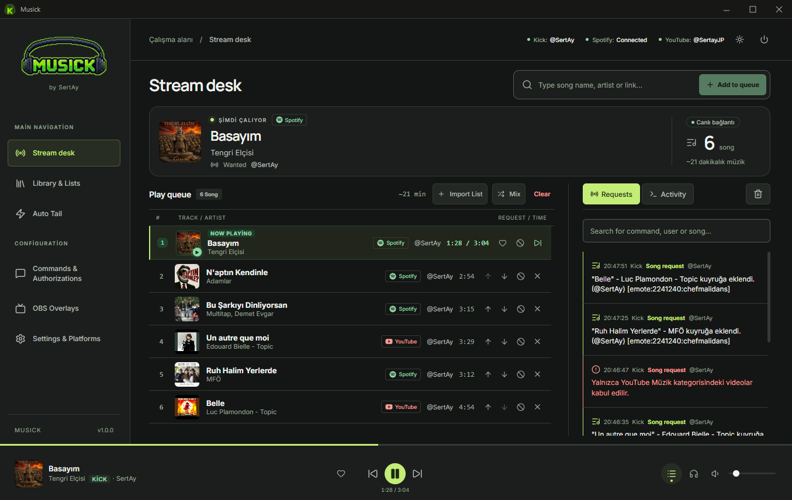
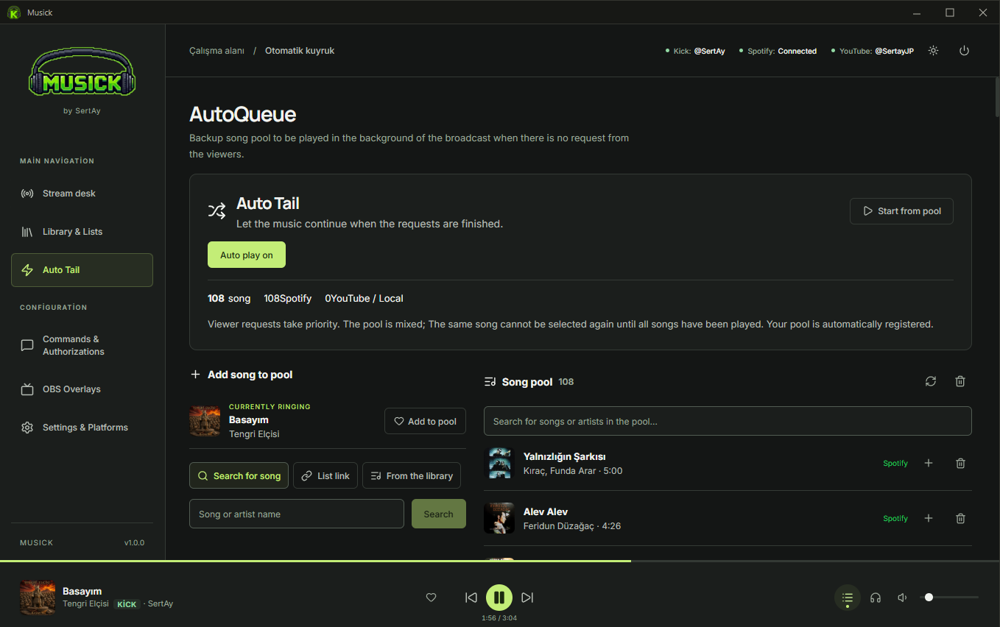
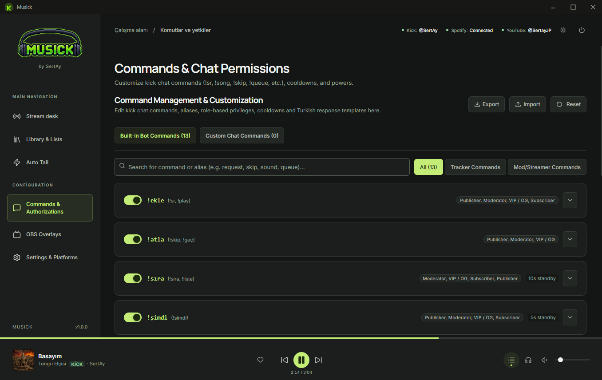
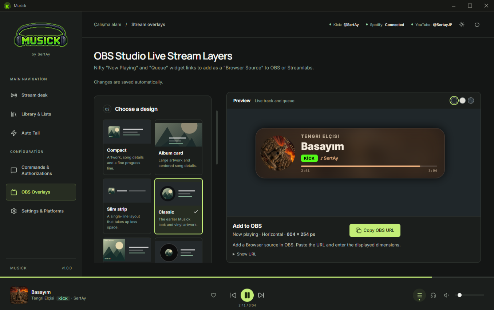

<h1 align="center">Musick</h1>

<div align="center">
  
  <p><strong>by SertAy · v1.0.0 · Windows x64</strong></p>
  <p><strong>(EN)</strong> Take music requests from Kick chat, manage Spotify and YouTube playback, and show the current song in OBS.</p>
  <p><strong>(TR)</strong> Kick sohbetinden şarkı istekleri al, Spotify ve YouTube çalma sırasını yönet, çalan şarkıyı OBS'de göster.</p>
  <a href="#en-setup-and-usage-guide"></a>
  <a href="#tr-kurulum-ve-kullanım-rehberi"></a>
  <a href="https://github.com/sertay1/musick/releases"></a>
</div>

---

## 📸 Screenshots / Ekran Görüntüleri

### Stream Desk / Yayın Masası



### Auto Queue / Otomatik Kuyruk



### Commands & Permissions / Komutlar ve Yetkiler



### OBS Overlays / OBS Katmanları



---

## (EN) Setup and Usage Guide

### ✨ Features

- **Live requests:** Take requests from Kick chat and follow commands and queue changes in the activity log.
- **Spotify and YouTube:** Control Spotify desktop playback and play YouTube music in Musick.
- **Library and automatic queue:** Import playlists and keep music playing from your selected pool when requests run out.
- **Chat controls:** Customize command aliases, role permissions, cooldowns, and bot replies.
- **OBS overlays:** Show the current track and upcoming songs using customizable layouts.

### ⚙️ Step 1 — Before you start

Musick runs on Windows x64. Install and open Spotify desktop if you plan to play Spotify tracks. Have your Kick channel name and the account you want the bot to use ready.

### 💾 Step 2 — Install Musick

1. Download the Windows setup EXE from [Releases](https://github.com/sertay1/musick/releases).
2. If you're updating, quit Musick from the system tray first.
3. Run the installer. It includes the .NET runtime and downloads WebView2 if needed.

### 🔑 Step 3 — Get developer credentials

- **Kick:** Create an app in [Kick Developer Settings](https://kick.com/settings/developer). Musick requests `user:read` for account details and `chat:write` for bot replies.
- **Spotify:** If the app asks for developer credentials, create an app in the [Spotify Developer Dashboard](https://developer.spotify.com/dashboard). Use the redirect address shown in Musick's Spotify settings.
- **YouTube:** Public music playback works without signing in. Playlist and like sync uses Google's sign-in flow. See the [YouTube setup guide](docs/YOUTUBE-TARAYICI.md) for account and distribution requirements.

### 📝 Step 4 — Connect your accounts

In **Settings → Accounts**, enter your credentials under the corresponding platform. Set the Kick channel to the chat that receives commands. Sign in with the account that should send replies. Connect Spotify there if you use it.

### 🎵 Step 5 — Take requests and add an OBS overlay

1. Send `!ekle song name` in Kick chat. The request appears in the broadcast desk. Use `!atla` to skip if you have permission.
2. Use **Commands & Permissions** to set aliases, permissions, cooldowns, and reply templates.
3. Pick a design in **OBS Overlays**. Copy the URL from the OBS setup area, paste it into a **Browser** source in OBS, and use the dimensions shown in Musick.

### 🔗 Contact

**SertAy** · [Linktree](https://linktr.ee/yamanx) · [Report an issue](https://github.com/sertay1/musick/issues)

---

## (TR) Kurulum ve Kullanım Rehberi

### ✨ Özellikler

- **Canlı istekler:** Kick sohbetinden şarkı isteği al. Komutları ve sıra değişikliklerini etkinlik günlüğünde takip et.
- **Spotify ve YouTube:** Spotify masaüstü oynatıcısını kontrol et ve YouTube müziklerini Musick içinde çal.
- **Kütüphane ve otomatik kuyruk:** Listeleri içe aktar. İstekler bittiğinde seçtiğin havuzdan müzik çalmaya devam et.
- **Sohbet komutları:** Takma adları, rol izinlerini, bekleme sürelerini ve bot yanıtlarını düzenle.
- **OBS katmanları:** Çalan şarkıyı ve sıradaki parçaları özelleştirilebilir tasarımlarla yayına ekle.

### ⚙️ 1. Aşama — Başlamadan önce

Musick Windows x64 üzerinde çalışır. Spotify'dan şarkı çalacaksan masaüstü Spotify uygulamasını kur ve aç. Kick kanal adını ve botun sohbete yanıt vermesini istediğin hesabı hazırla.

### 💾 2. Aşama — Musick'i kur

1. [Releases](https://github.com/sertay1/musick/releases) bölümünden Windows kurulum EXE'sini indir.
2. Güncelleme yapıyorsan önce Musick'i sistem tepsisinden tamamen kapat.
3. Kurulumu çalıştır. .NET çalışma zamanı pakete dahildir. Gerektiğinde WebView2 indirilir.

### 🔑 3. Aşama — Geliştirici bilgilerini al

- **Kick:** [Kick geliştirici ayarları](https://kick.com/settings/developer) sayfasından bir uygulama oluştur. Musick, bağlı hesabın bilgilerini okumak için `user:read`, sohbet mesajı göndermek için `chat:write` iznini ister.
- **Spotify:** Uygulama geliştirici bilgisi isterse [Spotify Developer Dashboard](https://developer.spotify.com/dashboard) üzerinden bir uygulama oluştur. Musick'in Spotify ayarlarında gösterilen dönüş adresini kullan.
- **YouTube:** Halka açık şarkıları çalmak için giriş gerekmez. Kendi listelerini ve beğenilerini eşitlemek, Google hesabıyla giriş gerektirir. Hesap ve dağıtım koşulları için [YouTube bağlantı rehberine](docs/YOUTUBE-TARAYICI.md) bak.

### 📝 4. Aşama — Hesapları bağla

**Ayarlar → Hesaplar** bölümünde geliştirici bilgilerini ilgili platforma gir. Kick kanal adına komutların çalışacağı sohbetin kanalını yaz. Botun cevap vermesini istediğin hesapla giriş yap. Spotify kullanacaksan hesabını aynı menüden bağla.

### 🎵 5. Aşama — Şarkı isteği al ve OBS'ye ekle

1. Kick sohbetine `!ekle şarkı adı` yaz. İsteği **Yayın masası** ekranından takip et. Yetkin varsa `!atla` ile sonraki şarkıya geç.
2. **Komutlar & Yetkiler** ekranında takma adları, izinleri, bekleme sürelerini ve yanıt şablonlarını düzenle.
3. **OBS Overlay'leri** bölümünde bir tasarım seç. **OBS'ye Ekle** alanındaki adresi OBS'de bir **Tarayıcı** kaynağına yapıştır ve gösterilen ölçüleri gir.

### 🔗 İletişim

**SertAy** · [Linktree](https://linktr.ee/yamanx) · [Sorun bildir](https://github.com/sertay1/musick/issues)

---

## 🛠️ Development / Geliştirme

Windows · .NET 9 SDK · Node.js · WebView2 Runtime

```powershell
cd src/MusicBot.Web/clientapp
npm ci
npm run build
cd ../../..
dotnet run --project src/MusicBot.Desktop
```

```powershell
dotnet test src/MusicBot.Tests --filter "FullyQualifiedName!~LiveTests"
powershell -ExecutionPolicy Bypass -File scripts/Package-Release.ps1 -Version 1.0.0
```

## 📄 License / Lisans

[LICENSE-SERTAY.txt](LICENSE-SERTAY.txt) covers contributions that SertAy is authorized to license. Rights to inherited code remain with their respective holders. See [THIRD-PARTY-NOTICES.md](THIRD-PARTY-NOTICES.md) for third-party licenses.

SertAy'ın lisanslama yetkisine sahip olduğu Musick katkılarının koşulları [LICENSE-SERTAY.txt](LICENSE-SERTAY.txt) dosyasında yer alır. Devralınan kodun hakları ilgili hak sahiplerine aittir. Üçüncü taraf lisansları [THIRD-PARTY-NOTICES.md](THIRD-PARTY-NOTICES.md) dosyasındadır.
