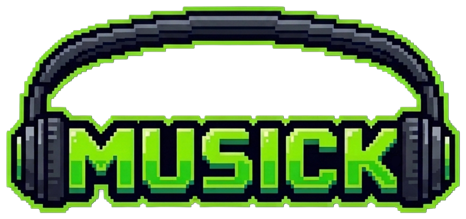

<p align="center">
  
</p>

# Musick

**by SertAy · v1.0.0 · Windows x64**

**TR** · Musick, Kick yayınlarında sohbetten Spotify ve YouTube şarkı istekleri almanı, çalma sırasını yönetmeni ve çalan şarkıyı OBS'de göstermeni sağlayan bir masaüstü uygulaması.

**EN** · Musick is a desktop app for Kick streamers. Take Spotify and YouTube song requests from chat, manage the playback queue, and show what's playing in OBS.

[İndir / Download](https://github.com/sertay1/musick/releases) · [Türkçe rehber](#türkçe-kurulum-ve-kullanım) · [English guide](#english-setup-and-usage) · [Sorun bildir / Report an issue](https://github.com/sertay1/musick/issues)

## Türkçe kurulum ve kullanım

### Özellikler

- Kick sohbetinden `!ekle` ile şarkı isteği, `!atla` ile sıradaki şarkıya geçme. Komut takma adları, rol izinleri, bekleme süreleri ve bot yanıtları uygulamadan düzenlenebilir.
- Spotify masaüstü oynatıcısıyla eşitleme ve YouTube müzik istekleri için gömülü oynatıcı.
- Yayın masasında çalma sırası, canlı istek akışı ve etkinlik günlüğü. Kütüphaneden liste aktarımı ve sıra boşaldığında otomatik kuyruk.
- OBS için özelleştirilebilir şarkı katmanları. Türkçe ve İngilizce arayüz, açık ve koyu tema.

### 1. Musick'i kur

[Releases](https://github.com/sertay1/musick/releases) sayfasından Windows kurulum EXE'sini indirip çalıştır. .NET çalışma zamanı pakete dahildir. WebView2 eksikse kurulum sırasında indirilir. Güncelleme yapıyorsan önce Musick'i sistem tepsisinden tamamen kapat.

### 2. Hesapları bağla

- **Kick** · **Ayarlar → Hesaplar** bölümüne, komutların çalışacağı kanalın adını yaz. Sohbete bot hesabının cevap vermesini istiyorsan bağlantıyı o hesapla kur. Geliştirici uygulaması bilgileri için [Kick geliştirici ayarlarını](https://kick.com/settings/developer) aç.
- **Spotify** · Hesabını Ayarlar'dan bağla ve Spotify masaüstü uygulamasını aç. Oynatma ve ses kontrolü Spotify üzerinden yürür.
- **YouTube** · Halka açık şarkıları çalmak için hesap bağlantısı gerekmez. Kendi listelerini ve beğenilerini eşitlemek için [YouTube bağlantı rehberini](docs/YOUTUBE-TARAYICI.md) izle.

### 3. Şarkı isteği al ve OBS'ye ekle

1. Kick sohbetine `!ekle şarkı adı` yaz ve isteğin **Yayın masası** ekranında göründüğünü kontrol et.
2. **Komutlar & Yetkiler** bölümünden kimlerin şarkı isteyebileceğini, şarkı atlayabileceğini ve botun ne yazacağını ayarla.
3. **OBS Overlay'leri** bölümünde bir tasarım seç. **OBS'ye Ekle** alanındaki bağlantıyı kopyala ve OBS'de bir **Tarayıcı** kaynağına yapıştır.

## English setup and usage

### Features

- Kick chat requests and skip commands with configurable aliases, role permissions, cooldowns, and bot replies.
- Spotify desktop playback controls and an embedded player for YouTube music requests.
- Live request feed, activity log, playlist imports, and an automatic queue that fills in when requests run out.
- Customizable OBS music overlays, Turkish and English interface, and light and dark themes.

### 1. Install Musick

Download the Windows installer from [Releases](https://github.com/sertay1/musick/releases) and run it. The .NET runtime is bundled. The installer downloads WebView2 if needed. If upgrading, quit Musick from the system tray first.

### 2. Connect your accounts

- **Kick** · In **Settings → Accounts**, enter the channel where commands should run. Connect the account you want to send chat replies. Developer credentials are available in [Kick developer settings](https://kick.com/settings/developer).
- **Spotify** · Connect your account in Settings and open the Spotify desktop app.
- **YouTube** · Public music playback works without signing in. To sync your own playlists and likes, follow the [YouTube setup guide in Turkish](docs/YOUTUBE-TARAYICI.md).

### 3. Take requests and add an OBS overlay

1. Send `!ekle song name` in your Kick chat and check the request on the broadcast dashboard.
2. Open the commands and permissions screen to configure who can request or skip songs and what the bot replies.
3. Pick a design in **OBS Overlays**, copy its URL, and paste it into an OBS **Browser** source.

## Geliştirme / Development

Windows, .NET 9 SDK, Node.js ve WebView2 Runtime gerekir. Musick; WPF, ASP.NET Core, React ve SQLite kullanır.

```powershell
cd src/MusicBot.Web/clientapp
npm ci
npm run build
cd ../../..
dotnet run --project src/MusicBot.Desktop
```

Test ve Windows kurulum paketi / Tests and Windows installer:

```powershell
dotnet test src/MusicBot.Tests --filter "FullyQualifiedName!~LiveTests"
powershell -ExecutionPolicy Bypass -File scripts/Package-Release.ps1 -Version 1.0.0
```

## Lisans / License

SertAy'ın lisanslama yetkisine sahip olduğu Musick katkılarının koşulları [LICENSE-SERTAY.txt](LICENSE-SERTAY.txt) dosyasında yer alır. Devralınan kodun hakları ilgili hak sahiplerine aittir. Üçüncü taraf lisansları [THIRD-PARTY-NOTICES.md](THIRD-PARTY-NOTICES.md) dosyasındadır.

[LICENSE-SERTAY.txt](LICENSE-SERTAY.txt) covers contributions that SertAy is authorized to license. Rights to inherited code remain with their respective holders. See [THIRD-PARTY-NOTICES.md](THIRD-PARTY-NOTICES.md) for third-party licenses.
